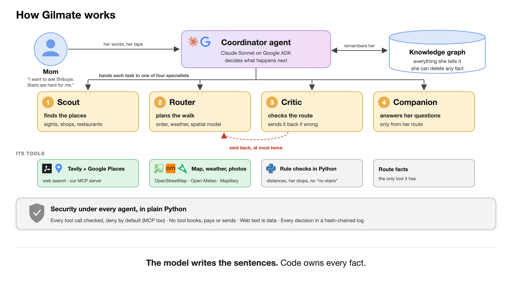
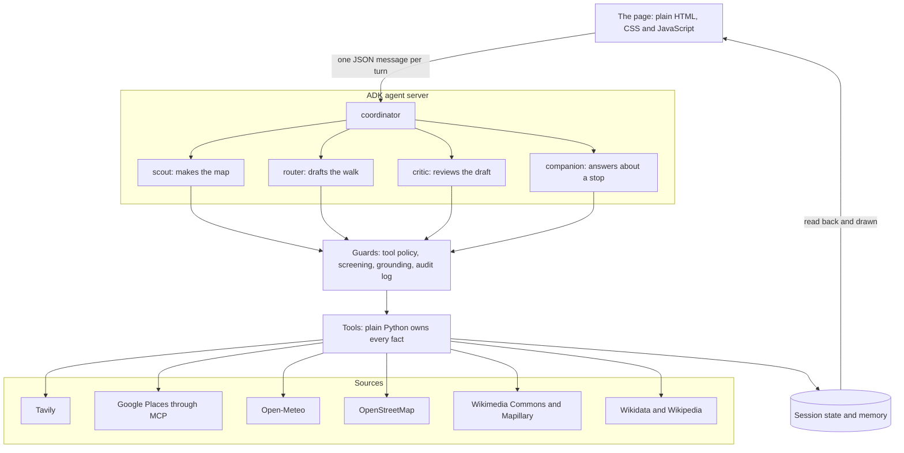

<p align="center">
  
</p>
<h1 align="center">Gilmate</h1>
<p align="center">
  A tour guide that plans around you, not the city.
</p>

Gilmate is a tour guide for people who find walking hard, and for those who plan for them.
It asks what you can manage, then builds one walk for the places you chose.
Every distance, stair, bench and warning comes from map data; what the map does not know is "unknown", never safe.

## What you do

1. **Type** where you want to go and how you walk.
2. **Watch** the agents make the map.
3. **Choose** two to five places, Yes or No.
4. **Tell** the guide what you can manage.
5. **Read** the route, its walks and its warnings.
6. **Take** it to your phone with a QR code.
7. **See** what it remembers, and forget any of it.

## How it works





## Agents

| Agent | Job |
| --- | --- |
| coordinator | Reads each turn and delegates |
| scout | Makes the map, a source for every fact |
| router | Orders your picks into one walk |
| critic | Reviews the draft, cannot change it |
| companion | Answers one question about a stop |

## Why you can trust it

- **Policy:** deny by default; one table of tools, limits and arguments.
- **Screening:** outside text is data, never an instruction.
- **Grounding:** a source and a quote for every fact.
- **Audit:** every decision is a row in a hash-chained log.
- **No actions:** no tool books, pays or sends. [SECURITY.md](SECURITY.md)

## Sources

Tavily, Google Places through our own MCP server, Open-Meteo, OpenStreetMap, Mapillary.

## Run it

```sh
uv venv --python 3.13 && source .venv/bin/activate && uv pip install -r requirements.txt
scripts/demo.sh --saved   # saved run: no key, no model, no search
scripts/demo.sh           # live agents; using the page costs money
```

Keys in `.env`: `ANTHROPIC_API_KEY`, `TAVILY_API_KEY`; optional `GOOGLE_API_KEY`, `MAPILLARY_TOKEN`.

## Checked

- Eighteen free drills (`scripts/drills.sh`): no network, no key, no model; all pass.
- A full live run through the page with the real model, 13:02 to 13:07 on 21 Nov 2026.
- Not tested: Hongdae against the live agents; nothing measured on site. [Details](docs/ARCHITECTURE.md#what-was-checked)

## Limits

- Two areas only: Shibuya in Tokyo and Hongdae in Seoul.
- "No stairs mapped" means the map shows none, not that none exist.
- Hongdae's data is thin: no place photos, most entrances unknown.
- The page has no field for the companion's questions yet. [All limits](docs/ARCHITECTURE.md#limits)

## Built with

Google ADK with Claude as the model; Gemini is not used. Map drawing and styling ported from Mercature by Glendon Chin (MIT), see [THIRD_PARTY.md](THIRD_PARTY.md). Photo credits: [CREDITS.md](CREDITS.md). Licence: MIT.
