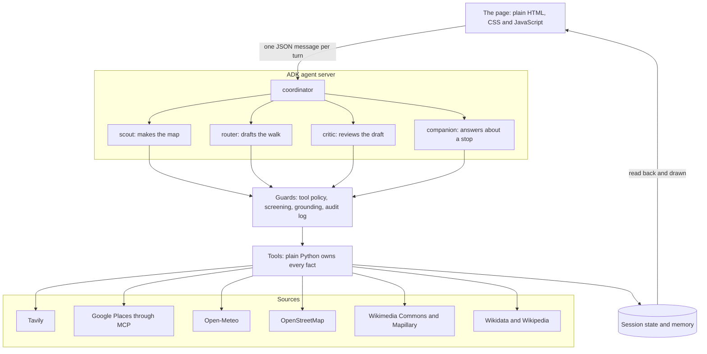

# Gilmate

A tour guide that plans around you, not the city.

## Overview

Most route planners know the city and nothing about the person walking it. Gilmate asks what you can manage, then builds one walk for the places you chose: every distance, stair, bench and warning comes from map data, and what the map does not know is written as "unknown", never as safe.

It is five agents on Google's Agent Development Kit (ADK), with Claude as the model. Gemini is not used. The model writes sentences. Plain Python owns every coordinate, distance, warning and source, and a set of guards in plain Python stands in front of every tool call.

Two areas have map data, Shibuya in Tokyo and Hongdae in Seoul. One real run of each is saved in the repository and shown as a card on the first screen, so the page runs without a key. The page speaks English and Korean.

What you do in it:

1. **Type where you want to go.** The text field comes filled in with the demo's sentence: "My mom wants to visit Shibuya in Tokyo. She loves sushi. Stairs and steep hills are hard for her, and she can walk about 1 km before she needs to sit down. Show us the sights and the best-rated sushi places." Python reads three things from these words: the area; the food you named, so the search for places to eat asks for it and those places come first; and how you walk, here stairs avoided, a walking limit of 1000 m and sitting often. Hills it cannot check, and the guide says so. For a place without map data it says so and offers nothing.
2. **Watch the map being made.** One line tells you what the agents are doing: searching the web, looking places up on the map, fetching photos, checking each fact against its source.
3. **Choose places.** One place at a time on a tilted street map, with real photos, what it is, its facts with their sources and how its entrance is tagged. Yes or No. Two to five Yes places make a route.
4. **Tell the guide about yourself.** One free text in your own words: how far you walk, stairs, how often you need to sit. Only what your words left open is asked again. When your first sentence already said it, nothing is asked and the guide shows what it understood.
5. **Read the route.** The order, each walk with its distance, stairs and benches, and each warning, written out in sentences, then drawn on the map.
6. **Take it with you.** A QR code on the final map opens the route on your phone, one stop at a time. After each walk you answer "Fine" or "Too far".
7. **See what it remembers.** The Knowledge graph tab fills as you decide. Every fact shows where it came from and what it changes, and you can forget any of them.

## How it works



A turn is one JSON message from the page. The coordinator reads its `step` and hands it to a specialist; the specialist calls tools; the tools write the session state; the page reads the state back and draws it. One turn followed end to end, the state keys and the caches: [docs/ARCHITECTURE.md](docs/ARCHITECTURE.md). The exact shapes: [CONTRACT.md](CONTRACT.md).

### The agents

| Agent | What it does | Its tools |
| --- | --- | --- |
| coordinator | Reads the step of your message and delegates. Never answers from its own knowledge. Records your own decisions. | `record_picks`, `record_said`, `record_context`, `record_feedback`, `forget_fact` |
| scout | Makes the map for where you want to go and says what each place is, with a source and a quote for every addition. | `read_request`, `search_places`, `find_candidates`, `describe_candidates`; with a Google key also `places_search`, `place_details` over MCP |
| router | Orders your picks into one walk that fits your answers and drafts it. | `walking_route`, `rest_spots`, `propose_route`, `weather_today` |
| critic | Reviews the draft against the facts and your answers. Cannot change the route. | `read_draft`, `submit_review` |
| companion | Answers one question about a stop, in the language of the question, from the route facts only. | `route_facts` |

All five run on Google ADK with Claude as the model, through ADK's Anthropic adapter. Gemini is not used. The model id is set in one place (`GILMATE_MODEL`).

### The guards

| Guard | What it does |
| --- | --- |
| Tool policy | One table of tools, call limits and allowed argument values, checked before every call. A tool that is not listed is refused, and that holds for tools that arrive over MCP. |
| Screening | Search results, Google Places records and typed text that read like an instruction are withheld before a model sees them. Every string of every tool answer is screened once more just before the model reads it. |
| Grounding | A fact needs a source that was read and a quote found in it. A written description is checked sentence by sentence; what its page does not support is cut. A rating is shown only when a source states it for that very place. |
| Route rule checks | The stops are your picks, every walk is reproducible from the map, and no sentence may promise "no stairs": the map can only say "no stairs mapped". |
| Review | After two reviews at the latest a route is published, as "verified" or as "partly unverified" with the open points listed. |
| Keys | Nothing shaped like a key may be a tool argument or reach the log. |
| Audit | Every decision is a row in a hash-chained log. The same rows are the steps the page shows. |

No tool books, pays or sends. What is defended, how it was tested and what is not defended: [SECURITY.md](SECURITY.md).

### The sources

| Source | What it gives | Key |
| --- | --- | --- |
| OpenStreetMap | Streets, routes, steps, benches, places and their access tags | none |
| Tavily | Web search: what visitors recommend, prices, hours | `TAVILY_API_KEY` |
| Wikimedia Commons, Mapillary | Photos with author and licence; street-level photos | none; `MAPILLARY_TOKEN` optional |
| Wikidata, Wikipedia | What a place is, in sentences that can be cited | none |
| Open-Meteo | Today's forecast and air quality for the area | none |
| Google Places, through an MCP server of our own | Rating with its number of ratings, opening hours, the entrance flag | `GOOGLE_API_KEY`, optional |

The searches, photos and cited texts of both areas are saved in `data/cache/` and committed, so a start turn costs no search and the checks need no network.

**Weather.** When a route is built, Python turns Open-Meteo's forecast into a fixed list of dangers: rain, thunderstorm, heat, UV, wind, cold, snow, ice, darkness, bad air. No model judges the weather. Rain likely or great heat lowers your walking limit by a quarter for this route, walks over it and walks that would end after sunset are flagged, and the route note says one line about it with its source. When the source does not answer, the route is built as without it and the log says so. The page shows the day's weather as a small mark in the top bar ("18° · Sunny") and as a step of the guide's narration.

**Google Places.** `gilmate/places_server.py` is a small MCP server over stdio that wraps the Places API (New) and only reads. The scout gets it through ADK's `McpToolset` when `GOOGLE_API_KEY` is set. A record is attached to a place only when the names agree and the points are at most 80 m apart; the map stays the truth for name, coordinates, access and routing. Without the key nothing changes.

## Memory

Gilmate remembers your answers, your picks and a walking limit it learns from "Too far" taps. One tap gives a limit 10 m below that walk, used for that day; a second tap keeps it. A learned limit never lifts the limit from your own answer. Only Python writes the memory, from your own answers and taps, never from web text or model text. "Forget this" deletes a fact.

## What was checked

| Check | Result |
| --- | --- |
| `scripts/drills.sh`: eighteen drills, one per behaviour of the guards, the plain Python and the page's list of areas. No network, no key, no model | All passed |
| `python3 scripts/demo_check.py`: the demo script under bash and zsh | All passed |
| `tests/e2e/check.py --map-first`, with and without `--context`: every turn on the real agent server, real tools and guards, a scripted stand-in for the model | All passed |
| The same turns against the real model, earlier today: four runs for Shibuya, one for Hongdae, 26 to 38 model calls each, no search | Three routes published as verified, two as partly unverified |
| A full live run through the page with the real model, Google Places and Open-Meteo, 13:02 to 13:07, on main at `e20eabd` | Passed, with no errors |
| The demo's sentence typed live after the last merge | Worked: about 65 s to the places, 29 s to the route |
| `frontend/dev/check_page.py`, `know-check.py`, `walk-check.py`: the page, the knowledge graph and the phone walk in a real browser at phone and desktop size | All passed: the page check on main at 13:20 (171 steps), the other two on main at 13:25 |

The free checks were run for this file on main as it was at 13:25 on 2026-11-21. The live runs are the operator's.

The saved runs, counted from the files:

| | Shibuya | Hongdae |
| --- | --- | --- |
| Places offered | 12: 4 sights, 4 shops, 4 places to eat | 10: 3 sights, 4 shops, 3 places to eat |
| Photos of the places themselves | 26 | 0 |
| Photos taken in the area | 1381: 418 street-level, 963 from Wikimedia Commons | 139: 23 street-level, 116 from Wikimedia Commons |
| Benches on the map | 11 | 19 |
| Route | 4 stops; walks of 345 m, 450 m and 375 m, all flagged as longer than the 300 m asked for | 4 stops; walks of 457 m, 135 m and 340 m, two flagged |
| Review | Partly unverified after two reviews, two open points | Verified after two reviews |
| Ratings shown | None: recorded before Google Places was merged, and no web page stated one | None, for the same reason |

## Limits

- The full live run through the page was made on main at `e20eabd`. The merges after it (the security pass, the knowledge graph that starts empty, Hongdae on the page, the panel look with the weather mark) were checked with the free drills. After the last merge, which lets the typed sentence shape the visit, the demo's sentence was typed live once more and worked.
- The Shibuya card under "Last runs" replays the run saved at 12:21, which was made with a shorter sentence ("I want to visit Shibuya in Tokyo") and before the typed sentence shaped the visit. It was not replaced: it shows no sushi-first order, no rating and no weather of its own.
- Hongdae on the page was walked in a browser on its saved run only, never against the live agents.
- Hongdae's data is thin: no photo of a place itself, street-level photos all from 2019, nearly every entrance "access unknown", 5 of 10 places without a description.
- The saved runs were recorded before the weather and Google Places were merged, so they hold no weather and no rating. With a Google key the place card shows Google's rating line ("4.9 · 17,274 ratings on Google") when Google returned one. The free checks cover the weather with made-up forecasts and Google Places with hand-written fixtures; the live run above used both for real.
- The weather mark on a saved run is not from that run: the page reads today's forecast for the area straight from Open-Meteo in your browser (only the area's coordinates are sent), and shows nothing when that does not answer.
- The page starts every visit with an empty knowledge graph and does not ask "Still true?" for answers remembered from an earlier visit. The server still keeps them.
- The companion and typed Yes / No answers work on the server. The page has no field that sends them.
- The climb on each walk is built and switched off: the heights it reads include buildings and were wrong on flat walks in Shibuya.
- Two sessions of different areas whose tool calls run at the very same moment are not protected from each other.
- The Korean the scout writes is a translation nobody proofread.
- Mapillary's photo links expire after some days.
- Nothing was measured on site. "No stairs mapped" means the map shows none on that path.

## Run it locally

The saved run needs no key, no model, no search and nothing installed beyond `python3`:

```sh
scripts/demo.sh --saved
```

It picks a free port, prints the address to open and stops on Ctrl-C. The page then asks two outside services from your browser: Mapillary for the street photos and Open-Meteo for the weather mark.

The live demo, with the real agents:

```sh
uv venv --python 3.13 && source .venv/bin/activate
uv pip install -r requirements.txt
cp .env.example .env          # then put your two keys in .env
scripts/demo.sh
```

Starting is free. Using the page calls the model and may search the web, which costs money. Run the install line again if you installed before 13:00 on 2026-11-21: the `mcp` package was added for Google Places.

On your phone: add `--phone` to either command. The page is then served to your Wi-Fi and the QR code on the final map opens the route on a phone in the same network. `--phone-live` also lets the phone's "Fine" / "Too far" reach the live agents, and the script says what that opens to your network.

| Name in `.env` | What it is for | Needed |
| --- | --- | --- |
| `ANTHROPIC_API_KEY` | The model behind all five agents | Live demo |
| `TAVILY_API_KEY` | Web search, asked only for a query that is not saved | Live demo |
| `GOOGLE_API_KEY` | Google Places for the scout. Needs "Places API (New)" and billing on the key's project | Optional |
| `MAPILLARY_TOKEN` | Fresh street-level photos. Without it the saved ones are used | Optional |
| `GILMATE_MODEL` | Another model id for all agents | Optional |

Two switches that are not keys: `GILMATE_WEATHER=off` leaves the weather out, `GILMATE_CLIMB=on` adds the climb.

```sh
scripts/drills.sh
python3 scripts/demo_check.py
python3 tests/e2e/check.py --map-first
```

`drills.sh` runs every `tests/drill_*.py` and fails when one fails. `demo_check.py` checks the demo script itself. `check.py --map-first` sends every turn the page sends to the real agent server, with a scripted stand-in for the model; it needs the virtualenv. All three are free. Every script and check, with what it costs and what it writes: [docs/SCRIPTS.md](docs/SCRIPTS.md).

## How it was built

In one day at the hackathon, by one person directing coding agents. Each agent worked in its own files; [CONTRACT.md](CONTRACT.md) is the one thing they shared and [AGENTS.md](AGENTS.md) is the working agreement. A behaviour counts only with a free check, and a paid run starts only on a human's word.

## Credits

Photos by their authors on Wikimedia Commons (CC BY, CC BY-SA, CC0 or public domain) and by Mapillary contributors (CC BY-SA 4.0); map data © OpenStreetMap contributors (ODbL). Every photo is listed with author, date, licence and source in [CREDITS.md](CREDITS.md).
Parts of the map drawing and the styling are ported from Mercature by Glendon Chin under the MIT licence, credited file by file in [THIRD_PARTY.md](THIRD_PARTY.md); the agents, tools, guards, memory and flow are written here. The QR code is drawn by Kazuhiko Arase's QR Code Generator (MIT) and the font is Aspekta (SIL Open Font License 1.1); both are in the same file with their licence texts.

Documentation: [architecture](docs/ARCHITECTURE.md) · [scripts and checks](docs/SCRIPTS.md) · [contract](CONTRACT.md) · [security](SECURITY.md)

Built at the DevFest Münster 2026 Agentic AI Hackathon.
